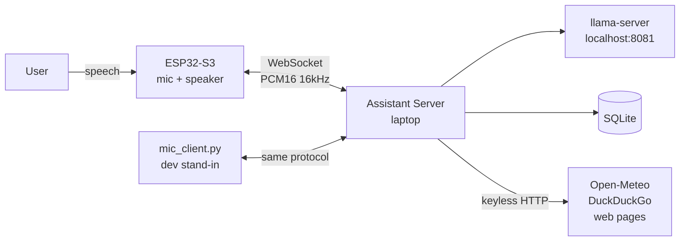
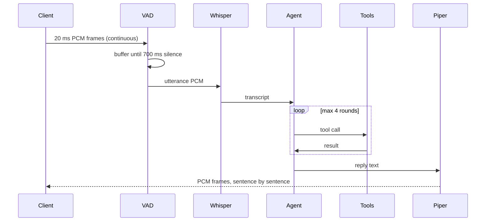

# High-Level Design

**Project:** Pico — local-first voice assistant
**Status:** server complete, firmware pending
**Target hardware:** Acer Nitro 5 — GTX 1050 Ti (4 GB VRAM), 8 GB RAM; ESP32-S3 client

---

## 1. Purpose

A always-available voice assistant that answers questions, takes notes and sets
reminders, built under three self-imposed constraints:

| Constraint | Consequence |
|---|---|
| **No paid API keys** | Every capability must have a keyless or self-hosted implementation. |
| **Runs on 4 GB VRAM** | Rules out models above ~4B parameters at Q4. |
| **Thin hardware client** | The ESP32 captures and plays audio only; all compute is on the laptop. |

The third constraint is the load-bearing one. It means the firmware never needs
to change when the assistant gets smarter, and it is why the server was built
first and tested with a laptop microphone.

---

## 2. Context

The laptop is reachable from outside the LAN through a Cloudflare Tunnel, because
a home connection has no static IP and the ESP32 cannot run a VPN client.

---

## 3. Request flow

Two properties of this flow matter more than the components themselves:

**Streaming output.** Piper synthesises one sentence while the previous one is
still being transmitted, so the user hears the first words long before the full
reply exists. Without this, a 40-word answer would have ~2 s of dead air.

**Server-side barge-in.** When VAD detects speech while the assistant is
speaking, the in-flight synthesis task is cancelled. Putting this on the server
rather than in firmware keeps the client stateless.

---

## 4. Component choices

| Stage | Choice | Alternative rejected | Reason |
|---|---|---|---|
| VAD | silero v5 (ONNX) | WebRTC VAD | WebRTC triggers on any noise; silero distinguishes speech. |
| STT | faster-whisper `base.en` | `large-v3` | On clean English the WER gap is negligible; `large-v3` is 10× the size and multilingual capacity is wasted. |
| LLM | Qwen3-4B-Instruct Q4_K_M | Llama-3.2-3B | Stronger tool-calling, which is the only capability that matters here. |
| TTS | Piper | Coqui / XTTS | Piper is ~60 MB, CPU-only, ~100× realtime. XTTS would compete for the GPU. |
| Embeddings | fastembed `bge-small-en-v1.5` | sentence-transformers | sentence-transformers pulls in PyTorch. |

### The no-PyTorch rule

Every model runs on **onnxruntime** or **CTranslate2**. A PyTorch install costs
roughly 2 GB of RAM and 2.5 GB of disk before loading a single weight — about a
quarter of total system memory on this machine. Avoiding it is the single
decision with the largest effect on whether the project runs at all.

### int8, not fp16

Pascal (compute capability 6.1) executes fp16 at **1/64** of fp32 throughput.
The nominally faster `int8_float16` compute type is therefore *slower* than
plain `int8` on a 1050 Ti. This is counter-intuitive enough that it is pinned in
`config.yaml` with a comment.

---

## 5. Intelligence model

A 4B model at Q4 has limited world knowledge and will state wrong facts
confidently. The design does not try to fix this — it routes around it.

> The model is treated as a **router and phraser**, not as a knowledge base.

| Capability | Source |
|---|---|
| Current facts, news, prices | `web_search` → `fetch_page` |
| Today's date and time | `now` |
| Weather | `weather` |
| Anything personal | `recall` over SQLite notes |
| Natural phrasing, intent detection | the model |

The system prompt states explicitly that the model does not know the date, the
weather, or recent events unless a tool says so.

### Why ten broad tools and not thirty narrow ones

Tool selection accuracy falls sharply with tool count for small models. One
`schedule` tool covering timers, alarms and reminders is chosen correctly far
more often than three near-synonymous tools.

There is a hard cost too: the JSON schemas occupy ~1000 tokens of a 4096-token
context on *every* request. Tool count is a context budget decision, not just an
ergonomic one.

---

## 6. Memory

Three layers, all in one SQLite file:

| Layer | Table | Lifetime | In prompt |
|---|---|---|---|
| Profile | `profile` | permanent | always |
| Conversation | `turns` | last 10 exchanges | always |
| Notes | `notes` | permanent | only on `recall` match |

Semantic search is a brute-force cosine product over all note embeddings. At the
scale of a personal assistant — thousands of notes, not millions — this is
sub-millisecond, and a vector database would add an operational dependency for
no measurable gain.

Reminders are polled from the database rather than held in an in-process
scheduler, so they survive a server restart.

---

## 7. Resource budget

| Component | VRAM | RAM |
|---|---|---|
| Qwen3-4B Q4_K_M, 36 layers | 2.4 GB | — |
| KV cache, 4k ctx, q8_0 | 0.2 GB | — |
| Whisper base.en int8 | 0.2 GB | 0.2 GB |
| Piper + embeddings + Python | — | 0.8 GB |
| Desktop compositor | 0.3 GB | — |
| **Total** | **~3.1 / 4 GB** | **~1.0 GB** |

Degradation path on CUDA OOM, in order: reduce `NGL` 36 → 28 → 20, move STT to
CPU, then drop to a Qwen3-1.7B GGUF.

**RAM, not VRAM, is the real constraint.** With 8 GB total, the OS and a browser
leave little headroom; this is why the dependency list is kept deliberately thin.

---

## 8. Security

The endpoint carries a live microphone feed. Exposed through a public tunnel,
an unauthenticated WebSocket is a room bug.

- Shared-secret token in the `hello` frame, compared with `secrets.compare_digest`
- Token read from `ASSISTANT_TOKEN`; the committed `config.yaml` holds only `change-me`
- TLS terminated by Cloudflare
- No audio is persisted — PCM lives in memory for the duration of an utterance
- Transcripts *are* persisted in `turns`; `data/` is gitignored

---

## 9. Latency target

| Stage | Budget |
|---|---|
| Silence detection | 700 ms (tunable) |
| Whisper base.en, GPU | ~300 ms |
| LLM, no tool call | ~400 ms to first token |
| LLM, with web search | +1–2 s |
| Piper, first sentence | ~150 ms |
| **Wake word → first audio** | **~1.5–2.0 s** |

The 700 ms silence threshold dominates. Lowering it clips natural pauses
mid-sentence; this is the main comfort/latency trade-off to tune in use.

---

## 10. Deferred

| Item | Why deferred |
|---|---|
| ESP32-S3 firmware | Server is testable with a laptop mic; hardware is a port, not a redesign. |
| Opus codec | Raw PCM is 256 kbit/s — fine on LAN, too heavy for a tunnel. |
| Wake word | Belongs on-device (`esp-sr`), so the server sees only intended speech. |
| Streaming STT | Needs partial-hypothesis handling; batch is fast enough at this utterance length. |
| Multi-user | Single-user by design; `device_id` exists so this is additive later. |

---

## 11. Known limitations

1. **4B reasoning ceiling.** Multi-step reasoning is weak. Mitigated by tools, not solved.
2. **Single tunnel dependency.** No Cloudflare, no remote access. LAN fallback exists.
3. **No echo cancellation.** The ESP32 will hear its own speaker. Needs AEC or a physical mic/speaker gap.
4. **English only.** `base.en` and the Piper voice are both English-specific.
5. **Reminder granularity is 10 s.** Fine for spoken reminders, unsuitable for precise timing.
