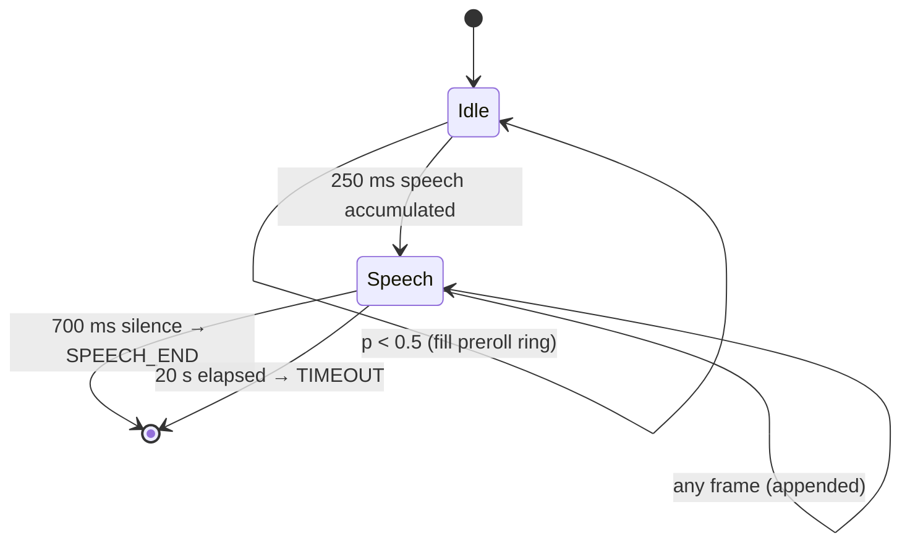
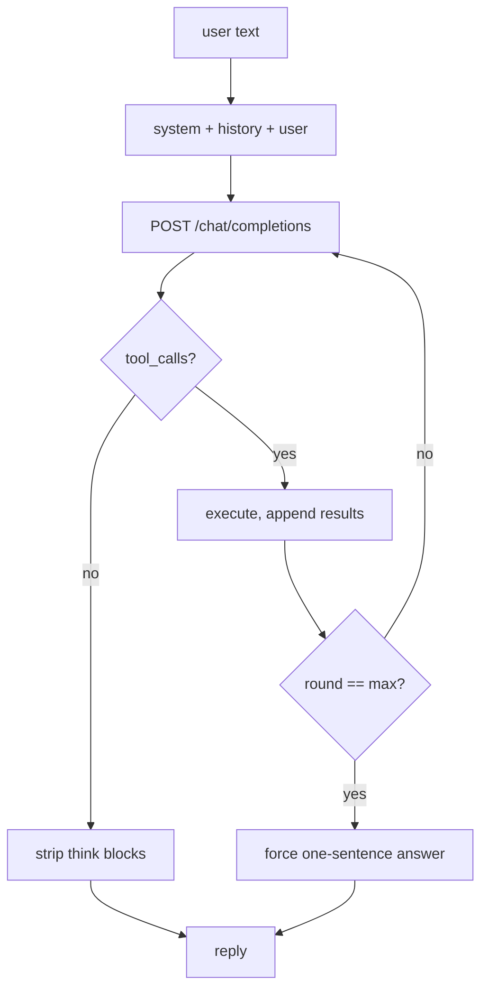

# Low-Level Design

Module-level reference for `pico-assistant`. Read [HLD.md](HLD.md) first for the
rationale behind these choices; this document covers *how*, not *why*.

---

## 1. Module map

| Module | Responsibility | Heavy imports |
|---|---|---|
| `server/config.py` | YAML load, env override, path resolution | — |
| `server/vad.py` | Streaming endpointer | onnxruntime |
| `server/stt.py` | Utterance → text | faster-whisper |
| `server/llm.py` | Agent loop, tool dispatch | httpx |
| `server/tts.py` | Text → PCM frames | piper |
| `server/memory.py` | SQLite + embeddings | fastembed |
| `server/scheduler.py` | Reminder polling | — |
| `server/main.py` | WebSocket, session, lifespan | fastapi |
| `server/tools/` | Tool registry + implementations | lazy |

Dependency direction is strictly one-way: `main` → everything; `tools` → `memory`
only through `ToolContext`. No module imports `main`.

---

## 2. Audio format

Fixed across the whole system. Any change breaks the firmware contract.

| Property | Value |
|---|---|
| Encoding | PCM signed 16-bit little-endian |
| Sample rate | 16 000 Hz |
| Channels | 1 |
| Frame | 20 ms = 320 samples = **640 bytes** |
| Bitrate | 256 kbit/s |

16 kHz is fixed by Whisper. 20 ms frames match typical I2S DMA buffer sizes.

---

## 3. Wire protocol

### Handshake

Client's first frame must be text:

```json
{"type": "hello", "token": "<shared secret>", "device_id": "esp32-living-room"}
```

10 s timeout; failure closes with **4401**. Token compared via
`secrets.compare_digest` — a plain `==` leaks length and prefix through timing.

### Client → server

| Frame | Payload | Meaning |
|---|---|---|
| binary | 640 bytes PCM | Audio. Sent continuously. |
| text | `{"type":"end"}` | Force-close the current utterance. |
| text | `{"type":"text","text":"..."}` | Skip STT. Used by `chat_client`. |
| text | `{"type":"reset"}` | Clear VAD state and conversation history. |

### Server → client

| Frame | Payload |
|---|---|
| text | `{"type":"ready"}` |
| text | `{"type":"state","value":"listening\|thinking\|speaking"}` |
| text | `{"type":"transcript","text":"..."}` |
| text | `{"type":"reply","text":"..."}` |
| binary | 640 bytes PCM (TTS) |
| text | `{"type":"audio_end"}` |
| text | `{"type":"push","text":"..."}` — unprompted, a reminder fired |

> **Implementation note.** All sends are serialised through a per-session
> `asyncio.Lock`. Binary audio frames and JSON control frames are written from
> different tasks; interleaving a JSON frame mid-audio-stream would be
> indistinguishable from audio to the client.

---

## 4. `vad.py` — endpointer

### silero constraints

The v5 ONNX model scores **only** 512-sample windows at 16 kHz (32 ms), and each
window must be prefixed with the **last 64 samples of the previous window** —
576 float32 values in total. Incoming frames are 320 samples, so windows are
reassembled from a byte buffer and the 64-sample context is carried forward.

```
inputs:  input (1,576) float32, state (2,1,128) float32, sr int64
         └─ 64 context samples ++ 512 new samples
outputs: probability (1,1),     new state
```

The input tensor is declared `(None, None)`, so passing a bare 512 is accepted
silently — it just returns garbage. Measured on clean speech: with the context
the peak probability is 1.00; without it, 0.065, which never crosses any usable
threshold. **This failure mode is invisible without a known-good audio fixture**,
which is why `tests/test_vad.py` asserts the 576-sample shape directly.

`state` is a recurrent hidden state. Along with the 64-sample context it is
per-speaker and per-utterance, so each connection owns an `Endpointer` instance
and `reset()` clears both between utterances.

### State machine



### Tuning

| Parameter | Default | Effect of lowering |
|---|---|---|
| `threshold` | 0.5 | More sensitive; triggers on background noise |
| `min_speech_ms` | 250 | Door slams become utterances |
| `silence_ms` | 700 | Faster replies; cuts off mid-sentence pauses |
| `max_utterance_ms` | 20000 | Safety cap — a noisy room cannot hang the pipeline |
| `preroll_ms` | 300 | Clips the first phoneme ("**S**et a timer" → "et a timer") |

**Pre-roll** is a ring buffer of pre-speech audio. Detection needs 250 ms of
speech to confirm, by which time the word has started; the pre-roll is prepended
so Whisper sees the complete word.

---

## 5. `stt.py` — transcription

```python
WhisperModel("base.en", device=_resolve_device("auto"), compute_type="int8")
```

`stt.device: auto` probes `ctranslate2.get_cuda_device_count()` and falls back
to CPU. CTranslate2 has no Metal backend, so macOS always resolves to CPU. A
failed GPU load is additionally caught and retried on CPU, because a driver
mismatch should degrade the assistant, not kill it.

Runs inside `asyncio.to_thread` — CTranslate2 releases the GIL, and the event
loop must keep draining the socket or the client's send buffer backs up.

| Setting | Value | Reason |
|---|---|---|
| `beam_size` | 1 | Greedy. Beam search costs ~2× latency for ~1 % WER. |
| `vad_filter` | False | The `Endpointer` already removed silence. |
| `condition_on_previous_text` | False | Prevents Whisper's known repetition-loop failure. |

Constructor falls back to CPU int8 if CUDA init fails — a dev laptop without
drivers should degrade, not crash.

---

## 6. `llm.py` — agent loop



### `--jinja` is mandatory

Without it, llama-server ignores the `tools` field entirely. The model then
answers from nonexistent knowledge instead of calling tools, and **nothing
errors** — the failure is silent and looks like a bad model. This is the single
most common misconfiguration.

### Round budget

`max_tool_rounds: 4`. On exhaustion the loop injects a user message demanding an
immediate one-sentence answer, rather than returning an error. A small model that
loops on `web_search` should still say something useful.

### Think-block stripping

Qwen3 may emit `<think>...</think>`. Unstripped, this is read aloud. Removed with
a `DOTALL` regex before the text reaches TTS.

### Failure handling

| Failure | Behaviour |
|---|---|
| llama-server unreachable | "I cannot reach my language model right now." |
| Unparseable tool arguments | Logged, treated as `{}` |
| Unknown tool name | Error string returned *to the model*, which can retry |
| Tool raises | Caught in the registry, error returned as tool output |

Tool errors are fed back as content rather than raised. A failed `web_search`
should let the model apologise, not kill the turn.

---

## 7. `tts.py` — speech synthesis

### Sentence splitting

Split on `[.!?]` + whitespace, then **merge fragments under 25 characters**.
Synthesising "Hi." alone produces an audible seam and wastes model warm-up, so
short pieces are merged into their neighbour.

### Pipelined synthesis

```
sentence 1 ──synthesise──┐
                         ├─ send 1 while synthesising 2
sentence 2 ──synthesise──┘
```

A one-sentence lookahead keeps the sender busy, hiding synthesis latency behind
playback.

### Resampling

Piper voices are 22 050 Hz; the wire format is 16 000 Hz. Linear interpolation
via `np.interp` — for speech at this ratio the artefacts are inaudible, and a
proper polyphase filter would mean adding scipy.

The final partial frame is zero-padded to exactly 640 bytes, because the ESP32
I2S DMA expects fixed-size buffers.

---

## 8. `memory.py` — persistence

### Schema

```sql
notes     (id, text, tags, created_at, embedding BLOB)
profile   (key PRIMARY KEY, value, updated_at)
turns     (id, role, content, created_at)
reminders (id, fire_at, text, repeat, fired, created_at)
```

`embedding` is a raw float32 `.tobytes()` buffer, restored with
`np.frombuffer`. No serialisation layer; dimensionality is fixed by the model.

### Threading

`check_same_thread=False` plus an explicit `threading.Lock`. `asyncio.to_thread`
dispatches to a pool, so the connection is touched from varying threads — but
never two at once, which is what SQLite actually requires.

### Semantic recall

```
vectors are L2-normalised at write time
score = matrix @ query_vector        # cosine, since both are unit vectors
filter score >= 0.35, take top 5
```

Normalising on write makes retrieval a single matrix multiply. The 0.35 floor
exists so an unrelated query returns *nothing* rather than the least-bad match —
a wrong note injected into the prompt is worse than no note.

---

## 9. `tools/` — registry

### Contract

```python
Tool(name, description, parameters, handler)
async def handler(ctx: ToolContext, **kwargs) -> str
```

`ToolContext` carries `cfg`, `memory`, `scheduler`. Handlers return **strings**:
tool output is prompt text, so it is formatted for a language model, not parsed.

### Catalogue

| Tool | Arguments | Notes |
|---|---|---|
| `now` | — | Prevents date hallucination |
| `weather` | `place?` | Open-Meteo; geocodes when `place` given |
| `web_search` | `query` | DuckDuckGo, or SearxNG if configured |
| `fetch_page` | `url` | trafilatura extraction, truncated to 6000 chars |
| `remember` | `text`, `tags?` | |
| `recall` | `query` | |
| `forget` | `note_id` | |
| `schedule` | `what`, `in_minutes?`, `at?`, `repeat?` | |
| `list_schedule` | `days?` | |
| `cancel_schedule` | `reminder_id` | |

### Date arithmetic stays in Python

`schedule` accepts a relative offset **or** a natural-language time — never a
computed timestamp. Small models are unreliable at date arithmetic, so the tool
description explicitly forbids it and `_resolve_time` does the work:

- `in_minutes` → `now + delta`, rejected if ≤ 0
- `at` → `dateutil.parser` with `fuzzy=True`, naive results localised
- **Past times roll forward a day** — "8 am" said at 9 pm means tomorrow

### Adding a tool

1. Write an async handler in a module under `server/tools/`.
2. Append a `Tool(...)` to that module's `TOOLS` list.
3. If it is a new module, add it to the tuple in `build_registry`.

Budget check: each tool adds ~100 tokens to every request.

---

## 10. `scheduler.py` — reminders

A 10-second polling loop over `reminders WHERE fired = 0 AND fire_at <= now`.
Polling rather than an in-memory scheduler because reminders must survive a
restart and the database is already the durable store.

**Catch-up.** For recurring reminders the next occurrence is rolled forward in a
loop until it is in the future. Without this, a laptop that was asleep for a week
would fire seven daily reminders at once on wake.

Exceptions inside a tick are logged and swallowed — one malformed row must not
kill the loop.

---

## 11. `main.py` — server

### Lifespan

Models load once in the FastAPI lifespan, not per connection — Whisper plus
embeddings take ~20 s. Shared singletons live in `state`; per-connection objects
live on `Session`.

| Scope | Objects |
|---|---|
| Process | `Memory`, `Transcriber`, `Speaker`, `Agent`, `ReminderService` |
| Connection | `Endpointer`, speaking task, send lock |

`Endpointer` **cannot** be shared: it holds recurrent state and a partial audio
buffer.

### Barge-in

`SPEECH_START` cancels the speaking task, emits `audio_end`, and returns to
listening. The client stops playback on `audio_end`, so no client-side logic is
needed.

### Push

`broadcast_push` iterates all sessions. A send failure on one device is logged
and skipped so a dead socket cannot block the others.

---

## 12. Configuration

Precedence: **environment > `config.yaml` > code defaults**.

| Variable | Overrides |
|---|---|
| `ASSISTANT_TOKEN` | `server.auth_token` |
| `LLAMA_BASE_URL` | `llm.base_url` |

Only secrets and deployment-specific endpoints are env-overridable; tuning stays
in YAML so it is reviewable in version control.

`Config.path()` resolves relative paths against the project root, so no module
needs to know where it was launched from.

---

## 13. Error handling policy

| Layer | Policy |
|---|---|
| Tool handler | Catch all, return error string to the model |
| Agent loop | Catch HTTP errors, return a spoken apology |
| STT init | Fall back CUDA → CPU |
| Reminder tick | Log and continue |
| WebSocket session | Log, close that session only |
| Config load | **Fail fast** — a bad config must not start |
| Missing model file | **Fail fast** with the download command in the message |

Rule of thumb: anything reachable from user speech degrades gracefully;
anything in startup fails loudly.

---

## 14. Testing

`tests/test_tools.py` is offline — no models, no network, no llama-server — so
it runs in CI in seconds.

| Covered | Not covered |
|---|---|
| Date resolution, including past-time roll-forward | VAD accuracy (needs audio fixtures) |
| Reminder create/list/cancel | STT accuracy |
| Invalid repeat, negative offset, missing time | End-to-end latency |
| TTS sentence merging and splitting | Tool-selection accuracy (needs the model) |
| Registry: unknown tool, bad arguments | |

`FakeMemory` substitutes for SQLite so scheduling logic is tested without I/O.

---

## 15. ESP32-S3 contract

What the firmware must do — the server side is already final.

| Requirement | Detail |
|---|---|
| Transport | WebSocket client, binary + text frames |
| First frame | `hello` JSON with token |
| Mic | I2S → PCM16 16 kHz mono, 640-byte frames |
| Speaker | Play binary frames; stop on `audio_end` |
| Wake word | `esp-sr` on-device; stream only after trigger |
| Reconnect | Exponential backoff; re-send `hello` |
| TLS | Pin the Cloudflare root CA |

Suggested pins: I2S mic BCLK/WS/DIN on GPIO 4/5/6, amp BCLK/LRC/DIN on GPIO
15/16/7. PSRAM required for audio buffering.
